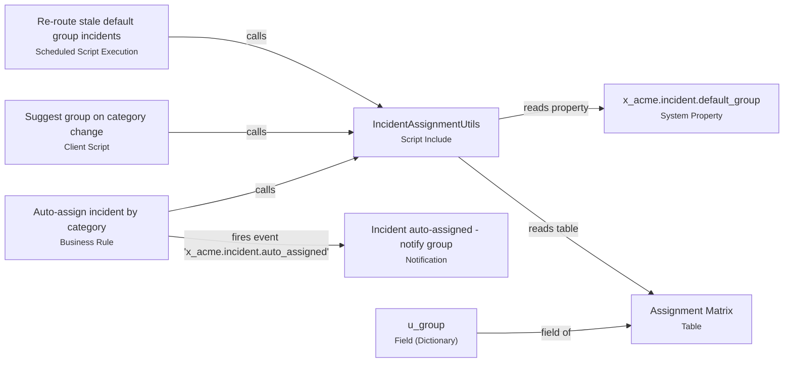

# STRY0012345 - Incident auto-assignment

This delivery is update set **STRY0012345 - Incident auto-assignment** (Global).

> Route new incidents to the right group automatically and escalate P1s.

It contains **10** component(s): 2 × Business Rule, 1 × Client Script, 1 × Field (Dictionary), 1 × Flow Designer, 1 × Notification, 1 × Scheduled Script Execution, 1 × Script Include, 1 × System Property and 1 × Table.
Built by jane.dev (10).

**Data touched:** `incident`, `u_assignment_matrix`, `incident_task` and `sys_user_group`.

### How the pieces fit together
- Business Rule **Auto-assign incident by category** calls → Script Include **IncidentAssignmentUtils**
- Business Rule **Auto-assign incident by category** fires event 'x_acme.incident.auto_assigned' → Notification **Incident auto-assigned - notify group**
- Client Script **Suggest group on category change** calls → Script Include **IncidentAssignmentUtils**
- Field (Dictionary) **u_group** field of → Table **Assignment Matrix**
- Scheduled Script Execution **Re-route stale default group incidents** calls → Script Include **IncidentAssignmentUtils**
- Script Include **IncidentAssignmentUtils** reads property → System Property **x_acme.incident.default_group**
- Script Include **IncidentAssignmentUtils** reads table → Table **Assignment Matrix**

### Where to start reading
These components are triggered by users, data changes or schedules (entry points):
- Business Rule **Auto-assign incident by category** — Server-side rule that runs **before** a record is **inserted** on `incident`, only when `current.category.changes() || current.assignment_group.nil()`.
- Business Rule **Sync priority to incident tasks** — Server-side rule that runs **after** a record is **updated** on `incident` (filter: `priorityVALCHANGES^EQ`).
- Client Script **Suggest group on category change** — Browser-side script that runs when the `category` field changes on `incident`.
- Flow Designer **P1 incident escalation** — Flow Designer flow triggered by **Created or Updated** on `incident` when `priority=1^active=true`, with 3 step(s).
- Scheduled Script Execution **Re-route stale default group incidents** — Background job that runs on a schedule (daily at 02:00:00).

### Review hot spots
- 🔴 **Sync priority to incident tasks** — Calls current.update() inside a business rule - this re-triggers business rules and can cause recursion. Use a 'before' rule and set fields directly instead.
- 🟠 **Re-route stale default group incidents** — Contains hard-coded sys_id values - these differ between instances. Use a system property or look the record up by a stable key.

## Component map

## Components

| Component | Type | Applies to | Status | Updated by | Review notes |
|---|---|---|---|---|---|
| [Auto-assign incident by category](artifacts/business-rule-auto-assign-incident-by-category.md) | Business Rule | incident | active | jane.dev |  |
| [Sync priority to incident tasks](artifacts/business-rule-sync-priority-to-incident-tasks.md) | Business Rule | incident | active | jane.dev | 1 |
| [Suggest group on category change](artifacts/client-script-suggest-group-on-category-change.md) | Client Script | incident | active | jane.dev |  |
| [u_group](artifacts/dictionary-u-group.md) | Field (Dictionary) | u_assignment_matrix | — | jane.dev |  |
| [P1 incident escalation](artifacts/flow-p1-incident-escalation.md) | Flow Designer | incident | active | jane.dev |  |
| [Incident auto-assigned - notify group](artifacts/notification-incident-auto-assigned-notify-group.md) | Notification | incident | active | jane.dev |  |
| [Re-route stale default group incidents](artifacts/scheduled-job-re-route-stale-default-group-incidents.md) | Scheduled Script Execution |  | active | jane.dev | 1 |
| [IncidentAssignmentUtils](artifacts/script-include-incidentassignmentutils.md) | Script Include |  | active | jane.dev |  |
| [x_acme.incident.default_group](artifacts/system-property-x-acme-incident-default-group.md) | System Property |  | — | jane.dev |  |
| [Assignment Matrix](artifacts/table-assignment-matrix.md) | Table |  | — | jane.dev |  |
